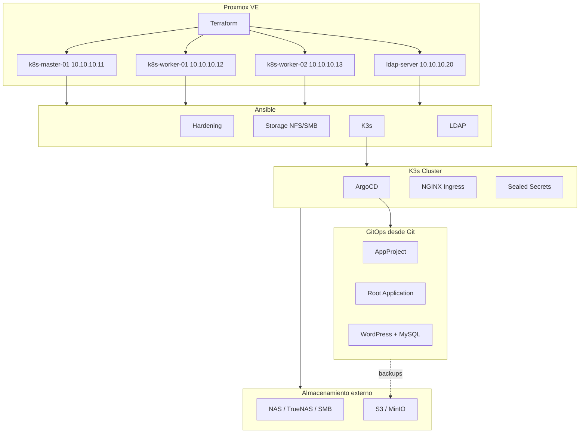

# ARQ3D — Infraestructura Proxmox · K3s · GitOps

[](https://github.com/AlfonsoSanM06/Arq3d-k8s-gitops/actions/workflows/ci.yml)
[](#)
[](#)
[](#)
[](#)

> Repo de infraestructura para montar un clúster Kubernetes desde cero sobre Proxmox VE, configurarlo con Ansible y desplegar aplicaciones con ArgoCD. Pensado como laboratorio reproducible y portfolio DevOps.
>
> **Estado:** funcional en entorno local. Algunos componentes (NFS dinámico, cert-manager, monitorización) están en desarrollo.

---

## TL;DR

```text
Terraform → VMs Proxmox → Ansible → K3s → Terraform/Helm → ArgoCD → WordPress
```

Si quieres levantarlo en tu máquina, salta directamente a [Cómo empezar](#cómo-empezar).

---

## ¿Qué hay aquí?

ARQ3D es un stack completo de infraestructura declarativa:

| Capa | Herramienta | Qué hace |
|---|---|---|
| **1. VMs** | Terraform + provider `bpg/proxmox` | Crea 4 VMs en Proxmox VE. |
| **2. Sistema operativo** | Ansible | Hardening, almacenamiento, K3s y OpenLDAP. |
| **3. Plataforma K8s** | Terraform + Helm | Instala ArgoCD, NGINX Ingress y Sealed Secrets. |
| **4. Aplicaciones** | ArgoCD (GitOps) | Despliega WordPress + MySQL desde Git. |

La idea es que todo el estado deseado esté en el repo: infraestructura, configuración del SO y workloads de Kubernetes. CI valida los cambios en GitHub Actions; CD corre exclusivamente por ArgoCD.

---

## Arquitectura general



> Los diagramas detallados del flujo de aprovisionamiento están en [`assets/`](assets/).

---

## Estructura del repositorio

Cada carpeta principal tiene su propio README con los detalles de esa capa.

```text
TFG-asir/
├── terraform-proxmox/          # Capa 1 — VMs en Proxmox
│   └── README.md
├── ansible/                    # Capa 2 — Configuración del SO
│   └── README.md
├── k8s-cluster/                # Capas 3 y 4 — K3s, ArgoCD y apps
│   ├── k8s_argocd/argocd_terraform/
│   ├── argocd-apps/
│   ├── wordpress/wordpress-mysql/
│   └── README.md
├── scripts/                    # Helpers para despliegue local
│   └── README.md
├── docs/                       # Arquitectura, decisiones y runbooks
│   ├── architecture.md
│   ├── context.md
│   ├── runbooks/
│   └── evolution.md
├── assets/                     # Diagramas
└── README.md                   # Este fichero
```

| Directorio | README | Responsabilidad |
|---|---|---|
| `terraform-proxmox/` | [README](terraform-proxmox/README.md) | Ciclo de vida de las VMs. |
| `ansible/` | [README](ansible/README.md) | Hardening, K3s, LDAP y montaje de storage. |
| `k8s-cluster/` | [README](k8s-cluster/README.md) | Controladores del clúster y aplicaciones GitOps. |
| `scripts/` | [README](scripts/README.md) | Scripts para levantar Proxmox en QEMU localmente. |

---

## Cómo empezar

Hay dos formas de desplegar el proyecto:

1. **Con Proxmox real** (bare-metal o ya instalado): usa [`docs/runbooks/bootstrap.md`](docs/runbooks/bootstrap.md).
2. **Local en tu PC sin hardware dedicado**: usa [`docs/runbooks/local-deployment.md`](docs/runbooks/local-deployment.md), que levanta Proxmox dentro de una VM QEMU mediante [`scripts/proxmox-vm.sh`](scripts/proxmox-vm.sh).

El flujo general es el mismo en ambos casos:

```bash
# 1. Aprovisionar VMs
cd terraform-proxmox/
cp terraform.tfvars.example terraform.tfvars
# edita terraform.tfvars con tus credenciales de Proxmox
terraform init && terraform apply
cd ../ansible/

# 2. Configurar SO
ansible-playbook site.yml --vault-password-file ~/.vault_pass

# 3. Instalar ArgoCD, NGINX y Sealed Secrets
cd ../k8s-cluster/k8s_argocd/argocd_terraform/
terraform init && terraform apply

# 4. Sellar secretos de MySQL y registrar root-app
cd ../../../
kubectl create secret generic wordpress-mysql-secrets \
  --from-literal=password='CAMBIA_ESTO' \
  --from-literal=root-password='CAMBIA_ESTO_TAMBIEN' \
  --namespace wp --dry-run=client -o yaml | \
  kubeseal --format yaml > k8s-cluster/argocd-apps/03-sealed-secret.yaml

kubectl apply -f k8s-cluster/argocd-apps/01-root-app.yaml
```

Para los pasos completos, variables, certificados TLS y troubleshooting, consulta los runbooks.

---

## Stack tecnológico

| Propósito | Tecnología | Versión aproximada |
|---|---|---|
| Hipervisor | Proxmox VE | 8.x |
| IaC (VMs) | Terraform + provider `bpg/proxmox` | >= 1.11 |
| Configuración SO | Ansible | >= 2.15 |
| Kubernetes | K3s | 1.28+ |
| GitOps | ArgoCD | 2.x |
| Ingress | NGINX Ingress Controller | 1.10+ |
| Secretos en Git | Sealed Secrets | 0.24+ |
| Aplicación demo | WordPress + MySQL | Helm chart custom |
| CI | GitHub Actions | — |

---

## Estado y próximos pasos

El proyecto está operativo como laboratorio. Esto es lo que ya funciona y lo que viene:

- [x] Aprovisionamiento declarativo de VMs con Terraform.
- [x] Hardening básico, K3s y OpenLDAP con Ansible.
- [x] ArgoCD, NGINX Ingress y Sealed Secrets desplegados vía Helm.
- [x] WordPress + MySQL gestionados por GitOps.
- [x] CI con `terraform validate`, `ansible-lint`, `helm lint` y validación de YAML.
- [ ] Provisionador dinámico de volúmenes (NFS/SMB).
- [ ] cert-manager para certificados TLS automáticos.
- [ ] Stack Prometheus + Grafana + Alertmanager.
- [ ] Backups automatizados de MySQL, WordPress y estado de ArgoCD.
- [ ] Alta disponibilidad del plano de control de K3s.

La hoja de ruta completa está en [`docs/evolution.md`](docs/evolution.md).

---

## Documentación adicional

- [`docs/architecture.md`](docs/architecture.md) — Componentes, flujos y límites de confianza.
- [`docs/context.md`](docs/context.md) — Red, entornos, dependencias y supuestos.
- [`docs/runbooks/`](docs/runbooks/) — Procedimientos operativos paso a paso.
- [`docs/decisions/`](docs/decisions/) — Decisiones técnicas documentadas.
- [`docs/errors/error_log.md`](docs/errors/error_log.md) — Incidencias y cómo se resolvieron.

---

## Autor y licencia

- **Autor:** Alfonso Sánchez
- **Repo:** [AlfonsoSanM06/Arq3d-k8s-gitops](https://github.com/AlfonsoSanM06/Arq3d-k8s-gitops)
- **Licencia:** MIT

Si usas este proyecto como base, adapta las IPs, dominios y secretos a tu entorno. No versiones nunca `terraform.tfvars`, kubeconfigs ni claves privadas.
