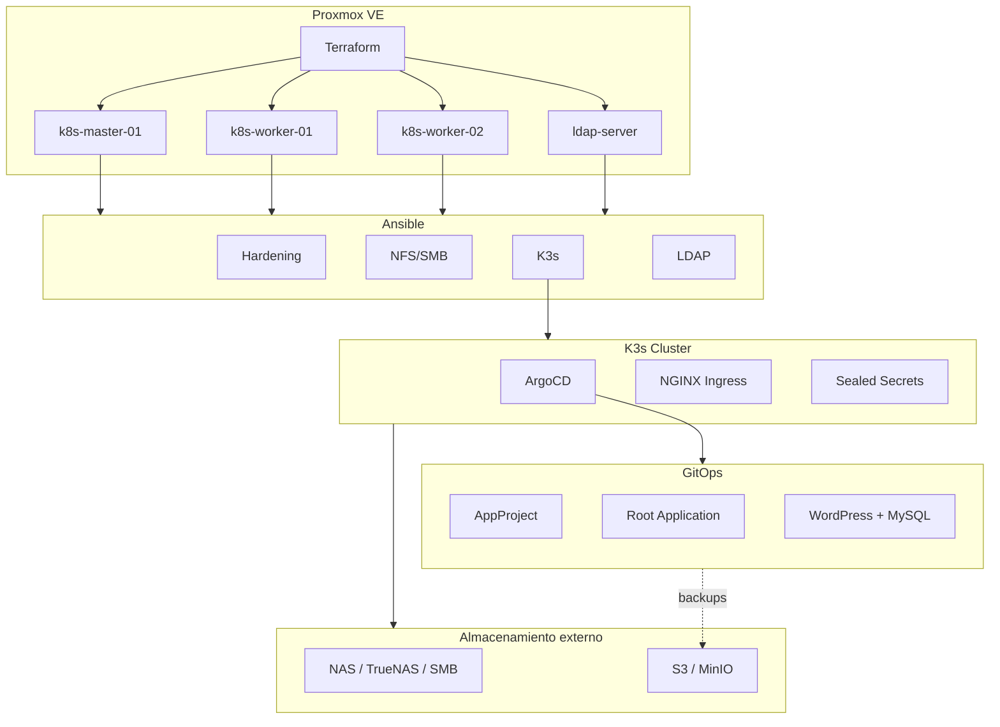

# Arquitectura de ARQ3D

## Visión general

ARQ3D se organiza en cuatro capas que se despliegan de forma secuencial. Cada
capa consume la anterior y añade funcionalidad.



## Componentes

### Capa 1 — VMs en Proxmox

| VM | IP | Rol |
|---|---|---|
| `k8s-master-01` | `10.10.10.11` | Plano de control de K3s. |
| `k8s-worker-01` | `10.10.10.12` | Carga de trabajo + ArgoCD. |
| `k8s-worker-02` | `10.10.10.13` | Carga de trabajo adicional. |
| `ldap-server` | `10.10.10.20` | OpenLDAP para identidad centralizada. |

Código fuente:

- [`terraform-proxmox/`](terraform-proxmox/)
- [`terraform-proxmox/modules/vm/`](terraform-proxmox/modules/vm/)

### Capa 2 — Configuración del sistema operativo

Orquestador: [`ansible/site.yml`](../ansible/site.yml)

| Playbook | Rol | Hosts |
|---|---|---|
| `01-hardening.yml` | SSH, UFW, fail2ban | `managed` |
| `02-nfs.yml` | Montaje de almacenamiento compartido | `k8s_cluster` |
| `03-k3s.yml` | Instalación de K3s master + workers | `k8s_cluster` |
| `04-ldap.yml` | OpenLDAP, estructura y políticas | `identity_servers` |

### Capa 3 — Controladores de Kubernetes

Instalados con Terraform/Helm:

| Controlador | Namespace | Función |
|---|---|---|
| ArgoCD | `argocd` | GitOps y sincronización de aplicaciones. |
| NGINX Ingress | `ingress-nginx` | Terminación HTTP/HTTPS. |
| Sealed Secrets | `kube-system` | Descifrado de secretos versionados. |

Código fuente:

- [`k8s-cluster/k8s_argocd/argocd_terraform/`](../k8s-cluster/k8s_argocd/argocd_terraform/)

### Capa 4 — Aplicaciones GitOps

| Recurso | Descripción |
|---|---|
| `00-appproject.yaml` | Permisos y límites del proyecto ArgoCD. |
| `01-root-app.yaml` | App-of-Apps que gestiona el directorio. |
| `02-wordpress-app.yaml` | Aplicación WordPress + MySQL. |
| `03-sealed-secret.yaml` | Credenciales MySQL cifradas. |

Código fuente:

- [`k8s-cluster/argocd-apps/`](../k8s-cluster/argocd-apps/)
- [`k8s-cluster/wordpress/wordpress-mysql/`](../k8s-cluster/wordpress/wordpress-mysql/)

## Flujo de datos

### Despliegue completo

```text
1. Terraform crea VMs en Proxmox.
2. Ansible configura SO, hardening, almacenamiento, K3s y LDAP.
3. Terraform/Helm instala ArgoCD, NGINX y Sealed Secrets.
4. Se genera SealedSecret de MySQL con kubeseal.
5. Se aplica root-app para que ArgoCD gestione aplicaciones.
6. Cada push a main es validado por CI; ArgoCD sincroniza el clúster.
```

### Flujo GitOps

```text
Git push -> GitHub Actions (CI) -> ArgoCD (CD) -> Kubernetes
```

GitHub Actions no accede al clúster; solo valida. ArgoCD es el único
componente que modifica el estado del clúster.

## Límites de confianza

- Proxmox es el hipervisor de confianza; debe protegerse su API.
- Las VMs se administran solo mediante SSH con clave pública; acceso root
  deshabilitado por contraseña.
- El tráfico LDAP está restringido a la VLAN 10.
- Las NetworkPolicies limitan qué pods pueden comunicarse.
- Los secretos en Git están cifrados mediante Sealed Secrets.
- TLS de aplicaciones y ArgoCD requiere secretes `wordpress-tls` y
  `argocd-server-tls`.

## Almacenamiento

### En vivo

Los datos activos residen en PVCs de Kubernetes. El backend concreto depende
de la decisión documentada en
[`decisions/storage-backend.md`](decisions/storage-backend.md):

- NFS/SMB externo compartido.
- `local-path` de K3s para laboratorios simples.

### Backups

Se recomienda destinar los backups a S3/MinIO:

- Dump de MySQL.
- Contenido de WordPress.
- Estado de ArgoCD.
- Clave de recuperación de Sealed Secrets.
- LDAP (LDIF exportado).

## Puntos críticos actuales

1. **Plano de control simple:** un único master de K3s.
2. **MySQL single-instance:** StatefulSet de una réplica.
3. **Almacenamiento:** pendiente de configurar el provisionador dinámico.
4. **TLS:** pendiente de cert-manager o certificados manuales.
5. **Observabilidad:** pendiente de Prometheus/Grafana/Alertmanager.

Ver [`evolution.md`](evolution.md) para el plan de mejora.
